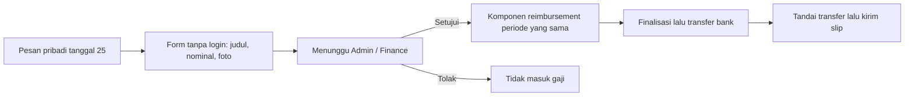
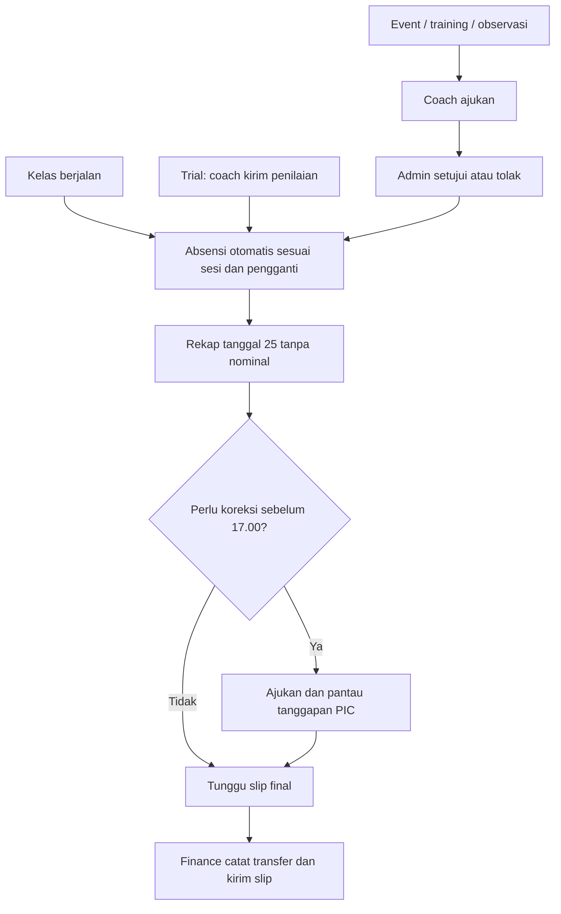
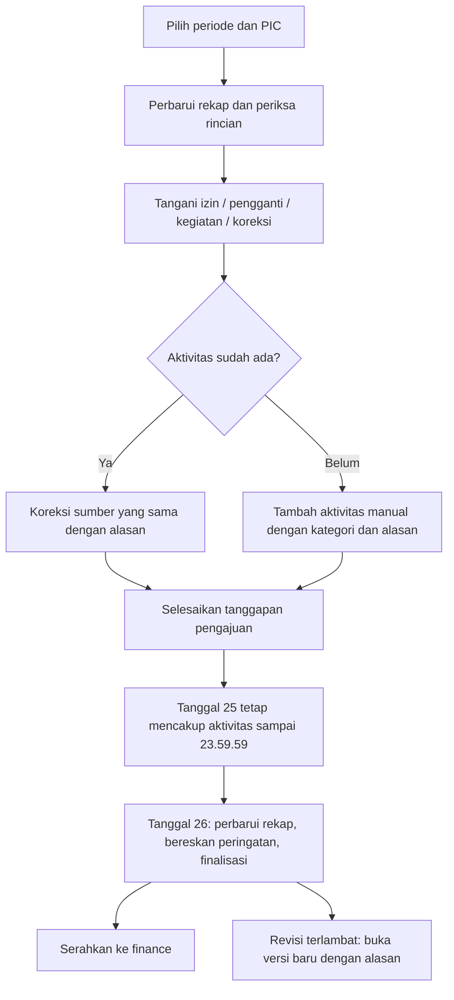
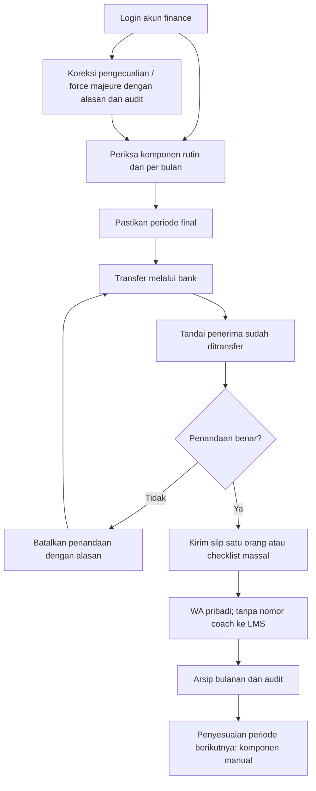

# Panduan Absensi, Gaji, dan Slip Gaji Clevio

Modul payroll tersedia di production. Jadwal WA mengikuti pengaturan otomatisasi admin. Data transisi dan arsip masuk satu rekap LMS; lihat [Sinkronisasi data payroll](./payroll-legacy-import.md).

## Mencoba di local

Jalankan `npm run dev:payroll-local`, lalu buka [pilihan akun demo](http://127.0.0.1:4055). Pilih Admin Demo Lokal, Coach Mitra, Coach Fulltime, atau Coach Tanpa WA. Data operasional demo adalah contoh. Pembanding n8n memakai snapshot baca saja yang dijelaskan di bagian uji paralel. Status **Simulasi local** berarti pengiriman teks rekap atau PDF slip disimulasikan tanpa mengirim WhatsApp sungguhan.

Login admin biasa juga tersedia di [halaman login local](http://127.0.0.1:3005/login): username **admin**, password **DemoLokal2026!**. Akun finance terpisah: **finance.demo**, password **DemoLokal2026!**, langsung membuka penggajian setelah login. Akun coach lead: **coachlead.demo**, password **DemoLokal2026!**, langsung membuka **Absensi & koreksi coach**; akun ini tidak mempunyai akses nominal gaji, transfer, atau PDF slip. Admin dengan beberapa tugas tetap membuka dashboard biasa. Kredensial ini hanya untuk database contoh lokal.

Database demo tersimpan terpisah di `.codex-payroll-local/database`. Menjalankan kembali perintah yang sama mempertahankan data. Untuk mengembalikan contoh awal, hentikan server lalu jalankan `npm run dev:payroll-local -- --reset`. Reset ini hanya menghapus database demo tersebut.

## Alur bulanan admin

Di **Rekap & arsip**, pilih bulan/tahun pada baris periode. **Perbarui rekap** dan **Finalisasi** berada di baris yang sama untuk periode draft. Tabel penerima langsung terlihat di bawahnya; jumlah penerima dan total ditampilkan sebagai ringkasan pendek. Buka **Info periode** untuk cutoff, deadline koreksi, dan syarat finalisasi. Area kerjanya dipisah:

| Area | Dipakai untuk |
| --- | --- |
| **Rekap penerima** | Memeriksa nominal, membuka rincian/pratinjau, membuat penyesuaian, dan melihat status rekap otomatis |
| **Pembayaran & slip** | Mencatat transfer yang sudah dilakukan dan mengirim slip; digunakan setelah periode final |
| **Riwayat periode** | Melihat audit, membuka revisi admin, serta memulihkan pengiriman yang menggantung |

Periode draft langsung membuka Rekap penerima. Periode final langsung membuka Pembayaran & slip. Checkbox hanya ada di **Pembayaran & slip**: centang penerima agar tombol transfer/kirim slip muncul. **Batal pilih** mengosongkan pilihan. Pindah area kerja juga mengosongkan pilihan untuk mencegah tindakan pada pilihan sebelumnya.

1. Buka **Keuangan → Gaji & Slip Gaji**. Pilih bulan/tahun; pilihan yang sama digunakan untuk membuka arsip bulan lama.
2. Klik **Perbarui rekap**. Periksa nama penerima, aktivitas, pengganti, nominal, dan peringatan. Sumber yang sama tidak dihitung dua kali.
3. Buka **Rincian** untuk melihat tabel dalam popup, memperbaiki sesi, memindahkan fee ke coach pengganti, mengatur mode sesi, atau memberi nominal khusus untuk force majeure. Alasan wajib diisi. Total langsung diperbarui setelah perubahan disimpan. **Pratinjau** membuka slip berlogo Clevio dalam popup tanpa mengunduh PDF. Slip merangkum seluruh fee kelas menjadi satu baris jumlah sesi dan total nominal; fee trial dan bonus goal juga diringkas. Gaji pokok, setiap tunjangan, potongan, dan komponen lain tetap tercantum masing-masing. Tanggal/nama sesi dan catatan koreksi lengkap tersedia di Rincian dan rekap absensi, bukan di slip.
4. Di popup Rincian, tombol **Tambahan / potongan** dan **Aktivitas manual** selalu berada di atas daftar. Klik untuk mengganti isi popup menjadi form khusus; tabel panjang disembunyikan sementara. Gunakan nominal negatif untuk potongan. **Kembali ke rincian** atau Escape kembali ke tabel. Penyimpanan berhasil otomatis kembali ke rincian; jika gagal, form dan isian tetap terlihat. Koreksi aktivitas memakai alur form yang sama. Pencatatan trial manual hanya untuk pengecualian admin dengan alasan; jalur normalnya otomatis dari penilaian trial. Hindari menambahkan kegiatan yang sudah terhitung dari LMS.
5. **Rekap absensi otomatis tanggal 25**, mulai 09.00 WIB, dengan pengingat terakhir mulai 16.00 WIB dan deadline koreksi 17.00 WIB. Otomatisasi harus diaktifkan di **Tarif & otomatisasi → Otomatisasi**, dan cron LMS harus berjalan. Rekap WA berupa pesan teks rinci tanpa nominal atau lampiran, untuk pemeriksaan absensi oleh coach; ini tidak menandai pembayaran. Status aktivasi terlihat di Rekap penerima dan Info periode. Di local, WA tetap disimulasikan. Kirim ulang manual hanya untuk pengecualian lewat **Rincian → Pengiriman ulang & riwayat penerima → Kirim ulang rekap (manual)**. Pengiriman manual lebih awal tidak menggantikan jadwal tanggal 25.
6. Setelah seluruh tanggal 25 selesai, klik **Finalisasi**. Sistem mengperbarui rekap sumber terbaru sebelum menyimpan versi final. Periode berjalan tidak dapat difinalisasi sebelum tanggal 26 pukul 00.00 WIB. Peringatan dan pengajuan koreksi berstatus Menunggu/Diproses harus diselesaikan dahulu.
7. Buka **Pembayaran & slip**. Lakukan transfer melalui bank. Setelah transfer benar-benar selesai, pilih penerima dan klik **Tandai sudah transfer**. Tombol ini mencatat penyelesaian transfer; tidak melakukan transfer bank. Jika pilihan berisi penerima yang sudah dan belum ditransfer, hanya yang belum selesai yang ditandai.
8. Pilihan penerima tetap tersimpan dan tombol utama berubah menjadi **Kirim slip gaji**. Klik untuk mengirim tanpa mencentang ulang. Untuk satu orang, cukup centang satu penerima; untuk massal, centang beberapa penerima atau semua hasil filter. Slip hanya dapat dikirim setelah final dan tercatat sudah ditransfer. Periksa hasil setiap penerima; kegagalan satu pengiriman tidak membatalkan hasil penerima lainnya.

Perhitungan, transfer, dan pengiriman memiliki status terpisah. Mengirim ulang slip tidak menambah pembayaran. Menekan penanda transfer kembali juga tidak menggandakan transfer yang sudah dicatat.

**Rekap penerima** tidak mempunyai tombol kirim rekap massal. Rekap normal dijadwalkan otomatis; **Pembayaran & slip** khusus untuk mencatat transfer dan mengirim slip. Jika masih draft, area pembayaran menjelaskan syarat finalisasi dan urutan transfer → slip.

## Periode dan deadline koreksi

Contoh periode **November 2026** mencakup **26 Oktober pukul 00.00 WIB sampai 25 November pukul 23.59.59 WIB**. Sesi tanggal 25 malam tetap masuk November. Aktivitas mulai tanggal 26 masuk periode berikutnya.

**BATAS LAPORAN KOREKSI REGULER COACH: TANGGAL 25 PUKUL 17.00 WIB.** Pesan ini tercantum di pesan teks rekap WA, notifikasi LMS, dan halaman coach. Form coach ditutup tepat pukul 17.00. Pesan coach tidak menawarkan pengecualian. **Catatan internal admin/PIC:** bila menerima laporan terlambat, perbaiki aktivitas yang sudah ada atau tambahkan kategori aktivitas yang belum tercatat, lengkap dengan tanggal, penerima, jumlah anak/online-offline bila relevan, serta alasan. Periode final harus dibuka revisi dahulu.

Tanggal 26 membuat periode baru. Riwayat bulan sebelumnya tetap tersimpan; tidak ada penghapusan absensi atau arsip gaji bulanan.

## Menyiapkan penerima dan kontrak

Di tab **Coach & staf**, klik **Tambah penerima** untuk membuka form dalam popup. Tambahkan coach dengan memilih akun LMS yang sudah ada. Pilih kontrak **Mitra** atau **Fulltime**, gaji tetap per periode, dan tanggal mulai berlaku. Kontrak dan nominal dikelola pada profil penerima oleh admin/finance. Nama coach mengikuti akun LMS. Nomor WhatsApp coach selalu diambil dari profil coach.

Untuk karyawan lain, pilih **Staf non-coach**. Isi nama, jabatan, nomor WA pribadi jika tersedia, kontrak, serta gaji pokok. Staf tidak perlu akun LMS; admin mengelola nomor WA staf di sini. Gunakan Fulltime jika penerima mempunyai gaji tetap.

Klik **Profil & tunjangan** di penerima untuk membuka popup pengaturan **Tunjangan jabatan** dan **Tambah tunjangan rutin lainnya**, misalnya komunikasi atau makan. Popup menutup setelah penyimpanan berhasil. Tunjangan rutin otomatis masuk satu kali setiap periode setelah **Perbarui rekap**, mengikuti tanggal berlaku kontrak. Untuk perubahan ke depan, isi tanggal **Berlaku mulai** yang baru. Versi final bulan lama tetap tersimpan. Tunjangan rutin mengikuti nominal bulanan penuh, tanpa prorata otomatis.

Untuk tunjangan atau potongan khusus satu bulan, buka **Rekap & arsip → pilih bulan → Rekap penerima → Rincian → Tambahan / potongan**. Isi label, nominal, dan alasan. Nominal negatif menjadi potongan. Komponen ini hanya berlaku pada periode yang dipilih; tidak berulang pada bulan berikutnya. Contoh: tunjangan jabatan rutin Rp500.000 disimpan di profil, sedangkan bantuan khusus November Rp250.000 ditambahkan di rincian November.

Gaji tetap merupakan nominal satu periode, tanpa prorata otomatis. Untuk masuk/keluar di tengah periode atau penyesuaian khusus, admin mencatat komponen tambahan/potongan beralasan. Perubahan kontrak dan tarif memakai tanggal berlaku. Versi final yang sudah tersimpan tidak ikut berubah.

## Cara menentukan hak fee

| Aktivitas / keadaan | Perhitungan |
| --- | --- |
| Sesi kelas yang berjalan | Otomatis masuk rekap sesuai jadwal; coach tidak perlu check-in |
| Aktivitas dibatalkan | Tidak dibayar |
| Izin coach disetujui tanpa pengganti | Tidak ada fee untuk coach yang izin |
| Ada coach pengganti | Fee masuk ke coach pengganti, bukan coach utama |
| Mitra mengajar kelas | Mendapat tarif sesi sesuai jenis kelas, online/offline, dan jumlah anak aktif |
| Fulltime, mode kelas Fulltime | Tercakup gaji tetap; tidak ada tambahan fee sesi |
| Fulltime, mode kelas Mitra | Mendapat fee mitra untuk kelas tersebut |
| Trial oleh coach mitra | Rp25.000 per sesi bersama setelah coach yang ditugaskan mengirim penilaian trial; satu fee meskipun beberapa anak |
| Trial oleh coach fulltime | Tidak mendapat fee trial; bonus goal tetap berlaku |
| Anak goal | Bonus awal Rp100.000 per anak; 5 anak = Rp500.000 |
| Transport | Diisi manual oleh admin |

Admin memilih mode Fulltime/Mitra saat membuat kelas. Untuk kelas yang sudah ada, buka **Kelas → detail kelas → Ubah mode** di bawah informasi coach utama. Pengaturan ini tidak lagi berada di Gaji & Slip Gaji. Tidak ada pemeriksaan jam kerja atau overlap. Untuk pengecualian satu pertemuan, gunakan **Koreksi aktivitas** pada rincian periode.

Jumlah anak dihitung dari kepesertaan aktif pada tanggal sesi, bukan jumlah anak saat ini dan bukan jumlah anak yang mengisi kehadiran. Kategori tarifnya 1, 2, atau 3+ anak.

Tarif awal kelas Weekly dan Ekskul:

| Cara belajar | 1 anak | 2 anak | 3+ anak |
| --- | ---: | ---: | ---: |
| Online | Rp70.000 | Rp80.000 | Rp100.000 |
| Offline | Rp95.000 | Rp105.000 | Rp125.000 |

Tarif awal event Rp180.000, training online Rp25.000, training offline Rp50.000, observasi online Rp25.000, dan observasi offline Rp50.000 per aktivitas. Admin dapat membuat kartu tarif baru dengan tanggal berlaku, termasuk mengubah observasi dan bonus goal untuk waktu berikutnya.

Tab **Tarif & otomatisasi** hanya menampilkan pengaturan yang dipilih: **Tarif aktivitas** untuk nominal dan tanggal berlaku, **Mode kelas** untuk status mengajar, atau **Otomatisasi** untuk tanggal mulai pencatatan dan jadwal rekap.

## Aktivitas tambahan yang diajukan coach

Pada halaman **Absensi & Slip Gaji**, coach mengisi jenis aktivitas, tanggal/jam WIB, nama kegiatan, serta rincian/lokasi/referensi bukti. Identitas mengikuti akun login; tidak perlu mengetik ID Telegram. Pengajuan hanya untuk kegiatan yang sudah berlangsung dan sebelum deadline reguler periode tersebut. Event, training, observasi online/offline, tersedia. Trial menggunakan modul Trial dan tidak dapat diajukan melalui form aktivitas tambahan.

Pengajuan berstatus **Menunggu admin** dan belum menambah gaji. Admin membuka tab **Pengajuan coach → Event & kegiatan**, memilih bulan/tahun langsung di bagian atas, lalu **Tinjau aktivitas**. Periksa kegiatan dan buktinya, tentukan Setujui/Tolak, pilih mode Mitra/Fulltime untuk kegiatan tersebut, dan isi alasan. Kembali ke **Rekap & arsip** dan klik **Perbarui rekap** setelah keputusan disimpan. Coach mendapat notifikasi keputusan di LMS dan dapat melihat riwayat pengajuan sendiri.

Pengajuan identik tidak dibuat dua kali. Trial tidak tersedia pada pengajuan coach untuk mencegah sumber absensi ganda. Admin dapat mengubah keputusan dengan alasan selama periode draft. Untuk periode final, buka revisi admin dahulu. Keputusan dan perubahan perhitungan dicatat bersama; versi final sebelumnya tetap utuh.

Konfirmasi invoice trial lunas yang sudah dipakai sistem pembayaran sekarang juga memicu sinkronisasi bonus goal. Bonus masuk ketika invoice pendaftaran berstatus **PAID** dan tanggal konfirmasi lunas tersedia. Callback berulang mengperbarui rekap sumber yang sama; tidak menambah bonus ganda. Gangguan penggajian tidak membatalkan konfirmasi pembayaran; Perbarui rekap/cron memperbaiki sinkronisasi. Tanggal konfirmasi menentukan periode bonus. Bonus diberikan kepada coach assessment trial, satu kali per anak. Pencocokan anak menggunakan nama dan nomor kontak pendaftaran yang dinormalisasi. Pastikan data anak konsisten; untuk riwayat pembayaran yang tidak lengkap, periksa peringatan sebelum memberi tambahan manual.

## Absensi trial otomatis

Admin meng-assign coach melalui modul Trial yang sudah ada. Setelah trial berlangsung, coach membuka trial miliknya, melengkapi form penilaian, lalu mengirimkannya. **Draft belum dihitung**. Absensi otomatis baru valid ketika penilaian terkirim oleh coach yang ditugaskan; tidak perlu formulir absensi kedua. Pencatatan ini memperbarui rekap absensi/estimasi. Pembayaran tetap diproses finance pada akhir bulan, kemudian ditandai sudah ditransfer dan slip dikirim manual. Satu sesi bersama menghasilkan satu fee trial, meskipun penilaian beberapa anak dikirim pada waktu berbeda. Bonus goal tetap dihitung per anak. Jika satu sesi memiliki beberapa anak, satu penilaian valid cukup mencatat satu sesi, tetapi laporan anak lain yang belum lengkap ditandai sebagai peringatan admin. Lengkapi laporan atau catat hasil pemeriksaan melalui Koreksi aktivitas sebelum finalisasi.

Tanggal sesi menentukan periode fee trial. Jika penilaian terlambat masuk dan periode sudah final, sistem memberi tahu admin tanpa mengubah slip final; admin membuka revisi jika perlu. Pengiriman penilaian memicu pencatatan absensi dan sinkronisasi rekap draft, dan cron/perbarui rekap dapat mengulang sinkronisasi bila sempat terjadi gangguan.

## Koreksi dan force majeure

Pilih penerima → **Rincian → Koreksi**. Untuk rekap jumlah, pilih **Ubah jumlah**, isi jumlah sesi yang benar, lalu alasan. Nominal mengikuti tarif secara otomatis; isi **0** jika seluruh sesi dibatalkan. Atau pilih **Pilih pertemuan**, centang tanggal/nama kelas yang benar, lalu simpan. Jumlah mengikuti pertemuan yang dicentang. Sesi batal tidak dapat dipilih, kategori kelas dibatasi sesuai online/offline dan jumlah anak, dan pertemuan yang sama tidak dapat dipakai dua kali.

Untuk sesi individual, buka **Pilih sesi** dari rincian kelas, cari pertemuannya, lalu **Koreksi**. Pilih dihitung/tidak dihitung atau coach pengganti. Mode dan nominal khusus ada di **Pengaturan lanjutan**. Nominal khusus milik finance tetap dipertahankan saat coach lead memperbaiki absensi; admin/finance dapat memilih kembali **Otomatis sesuai tarif**. Alasan wajib dan total langsung diperbarui setelah disimpan.

Rekap kumulatif yang belum memiliki tanggal/nama kelas tidak diberi tanggal perkiraan. Pertemuan yang dapat dilacak dari riwayat pencatatan diverifikasi otomatis. Lengkapi sisanya sebelum rekap detail dikirim. Jika belum lengkap saat jadwal pengiriman, admin diberi notifikasi dan rekap coach itu ditunda; tautan reimbursement tetap dikirim. Periode final harus dibuka revisi sebelum koreksi. Koreksi jumlah menyimpan selisih terhadap data saat dikoreksi, sehingga sesi baru berikutnya tetap ikut masuk; nominal khusus Finance tetap dipertahankan sampai diubah kembali ke tarif otomatis.

Untuk periode final, buka **Riwayat periode → Buka revisi admin**, isi alasan, lalu kembali ke **Rekap penerima** untuk melakukan koreksi dan finalisasi lagi. Sistem menyimpan versi baru dan mempertahankan versi lama serta semua catatan transfer. Jika sebelumnya sudah ditransfer Rp500.000 dan hasil revisi Rp550.000, sisa yang ditandai berikutnya Rp50.000. Jika penyesuaian disepakati masuk bulan berikutnya, admin/finance menambah komponen berlabel, nominal, dan alasan pada periode berikutnya. Tidak ada modul cicilan, penagihan kembali, atau pemindahan saldo otomatis. Nominal negatif adalah potongan; positif adalah tambahan.

## WhatsApp, notifikasi LMS, dan PDF

| Status | Artinya / tindakan |
| --- | --- |
| Belum dikirim | Belum ada pengiriman slip untuk versi ini |
| Terkirim WA / SENT | Pengiriman dokumen diterima layanan WhatsApp; bukan bukti sudah dibaca |
| Hanya LMS / LMS_ONLY | Coach tidak mempunyai nomor WA; notifikasi dan rincian tetap ada di akun LMS |
| Tanpa kontak / NO_CONTACT | Staf tidak memiliki nomor WA; admin diberi notifikasi. Lengkapi nomor melalui Profil & tunjangan, lalu kirim ulang |
| Gagal / FAILED | Periksa nomor/koneksi, lalu kirim ulang dari rincian penerima |
| Sedang dikirim / SENDING | Tunggu hasil; hindari menekan ulang |
| Simulasi local / SIMULATED | Khusus preview local: PDF dibuat, tidak ada pesan WA sungguhan |

Rekap berupa pesan ringkas: dikelompokkan per tanggal, berisi jam dan nama kelas/kegiatan, penanda pengganti/pembatalan, jumlah aktivitas, dan satu deadline tegas. Pengingat sore lebih singkat. Pesan tidak memuat nominal gaji atau lampiran; tautan form reimbursement pribadi disertakan sebelum deadline. File PDF hanya untuk slip gaji setelah finance menandai transfer, langsung ke nomor pribadi. Pengiriman ulang normal tidak menggandakan hasil yang sudah berhasil. Jika proses menggantung lebih dari 10 menit, admin dapat memulihkan status dengan alasan; periksa WA sebelum mencoba ulang.

## Reimbursement coach dan staf

Tanggal 25 mulai pukul 09.00 WIB, coach menerima tautan form bersama rekap. Staf non-coach menerima pesan khusus ke nomor WA pada profil staf. Coach tanpa nomor WA menerima tautan melalui notifikasi LMS; staf tanpa nomor WA ditandai agar admin melengkapi kontaknya.

1. Karyawan membuka tautan pribadinya tanpa login. Nama dan periode sudah ditentukan sistem; tautan tidak dapat dipakai memilih orang atau bulan lain.
2. Isi **judul pengeluaran**, **nominal rupiah**, dan unggah **foto bukti** JPG/PNG/WebP maksimal 5 MB. Foto dikompres menjadi WebP, maksimal 1600 piksel, dan metadata lokasi dibuang. Foto disimpan privat.
3. Pengajuan berstatus **Menunggu**. Pengiriman ulang identik tidak menggandakan pengajuan. Form ditutup tanggal 25 pukul 17.00 WIB; tautan pribadi jangan dibagikan ke orang lain.
4. Admin/finance membuka **Gaji & Slip Gaji → pilih periode → Reimbursement → Tinjau**. Periksa bukti lalu setujui/tolak dengan alasan. Persetujuan menambah satu komponen reimbursement pada gaji periode itu dan total dihitung ulang. Perubahan keputusan memperbarui komponen yang sama, bukan membuat salinan. Coach lead tidak mendapat akses nominal/bukti reimbursement.

Reimbursement yang disetujui tetap terlihat sebagai komponen tersendiri di slip. Pembayaran mengikuti alur finalisasi → transfer bank → tandai transfer → kirim slip. Persetujuan tidak melakukan transfer. Untuk mengubah keputusan periode final, buka revisi dahulu; arsip versi final sebelumnya tetap utuh.

## Penggunaan oleh coach

Buka **Absensi & Slip Gaji** melalui menu coach. Pilih arsip bulan/tahun untuk melihat rincian sendiri. Detail aktivitas pada halaman dan API coach tidak memuat nominal, tarif, gaji pokok, tunjangan, total, atau riwayat transfer. Sebelum deadline, coach dapat mengajukan koreksi dan memantau Menunggu → Diproses → Selesai/Ditolak, beserta tanggapan PIC. Pengajuan tidak langsung mengubah perhitungan. Setelah final dan transfer dicatat, tombol unduh slip final tersedia. Coach tidak dapat melihat slip orang lain atau mengubah tarif, kontrak, dan penanda transfer.

## Arsip dan akses admin

Di **Rekap & arsip**, pilih bulan/tahun untuk membuka periode berjalan maupun arsip lama. Pencarian nama/jabatan berada di sebelah tab area kerja; tombol **Filter** membuka pilihan coach/staf dan fulltime/mitra. Filter transfer dan status pengiriman tersedia di **Pembayaran & slip**. Total ringkasan mengikuti hasil filter; **Reset filter** mengembalikan daftar lengkap. Penjelasan cutoff, koreksi, dan finalisasi tersedia di **Info periode**. Ikon panah melingkar di sebelah judul memuat ulang data tanpa mengperbarui rekap gaji.

Popup Rincian menyediakan **Pengiriman ulang & riwayat penerima** yang dapat dibuka untuk pratinjau versi final sebelumnya, riwayat transfer, dan pengiriman ulang. Audit seluruh periode ada di **Riwayat periode**. Admin melihat slip melalui popup; file PDF tetap dipakai sebagai lampiran slip yang dikirim melalui WA. Tabel di layar kecil dapat digeser ke samping untuk melihat kolom tindakan.

Izin **Gaji & Slip Gaji** mengatur akses nominal, pembayaran, dan slip. Izin **Absensi & koreksi coach** memberi coach lead ruang kerja aktivitas tanpa nominal atau dokumen gaji. Coach lead memakai akun admin dengan izin menu terbatas ini, bukan superadmin. Admin dapat memberikan izin melalui pengaturan pengguna yang sudah ada.

**PIC operasional koreksi adalah admin dan coach lead. Finance tetap boleh mengoreksi, termasuk force majeure, dengan alasan dan identitas tercatat di audit.** Notifikasi koreksi masuk ke PIC dari kelompok admin/coach lead; bila PIC tidak aktif atau belum ditetapkan, fallback hanya ke kelompok operasional tersebut. Finance tidak menjadi penerima antrean rutin hanya karena mempunyai izin penggajian.

## Menangani koreksi dan salah penandaan transfer

Admin/coach lead membuka **Absensi & koreksi coach → Pengajuan koreksi**. Admin/finance juga dapat membukanya dari **Gaji & Slip Gaji → Pengajuan coach → Koreksi absensi**. Pilih PIC dari admin/coach lead yang mempunyai izin operasional. Perhitungan memilih aktor jika ia termasuk kelompok operasional; bila tidak, memilih PIC operasional yang tersedia. PIC finance lama diganti ke PIC operasional saat perhitungan berikutnya. Filter **Perlu ditangani** menampilkan Menunggu/Diproses; pilih Semua pengajuan untuk arsip.

PIC mengubah status menjadi **Diproses**, lalu klik **Periksa aktivitas coach** pada pengajuan. Daftar aktivitas langsung difilter ke coach tersebut. Pilih **Koreksi** untuk memeriksa penugasan/pengganti, mode, atau pengecualian aktivitas. Penyimpanan di ruang kerja absensi otomatis memperbarui daftar; **Perbarui absensi** digunakan bila ingin mengambil perubahan terbaru dari sumber. Aktivitas terlewat dapat ditambahkan dengan kategori, tanggal, jumlah anak, dan alasan. Setelah selesai memeriksa, PIC menandai pengajuan **Selesai** atau **Ditolak** dengan tanggapan. Di area penggajian, **Periksa aktivitas coach** membuka Rincian penerima; admin/finance tetap bisa melakukan koreksi beralasan. Tanggapan tampil di akun coach, jadi gunakan detail aktivitas tanpa nominal. Hasil disimpan dan coach menerima notifikasi LMS. Pengajuan selesai tidak dibuka ulang; perubahan berikutnya tetap dicatat lewat audit admin.

Di **Absensi & koreksi coach → Event & kegiatan**, tombol **Tinjau aktivitas** membuka popup keputusan, sehingga form tidak tersembunyi di bawah daftar panjang. Daftar aktivitas diperbarui setelah keputusan disimpan. Jika penyimpanan gagal, popup tetap terbuka dan menampilkan masalahnya. Tab kegiatan, aktivitas, dan pengajuan koreksi semuanya terlihat pada layar HP.

Jika salah menandai transfer: **Rincian → Pengiriman ulang & riwayat penerima → Riwayat transfer → Batalkan penandaan**. Isi alasan. Catatan transfer asli tetap ada dengan penanda pembatalan. Tindakan ini tidak menggerakkan uang bank. Penerima kembali belum dibayar, pengiriman slip diblokir, dan akses unduh coach dihentikan sampai penandaan yang benar dibuat. File yang sudah diterima sebelumnya tentu tidak dapat ditarik dari perangkat penerima.

## Satu rekap selama transisi

Buka **Rekap & arsip → Rekap penerima** untuk data berjalan dan arsip. **Perbarui rekap** mengambil data terbaru selama transisi. Ketika otomatisasi aktif, pembaruan sumber periode berjalan juga diperiksa setiap jam sebelum jadwal pesan; kegagalan pembaruan menunda pengiriman agar data lama tidak dikirim sebagai data terbaru. Rincian menampilkan aktivitas, jumlah, nominal dan total dalam satu popup. Tambahan/koreksi yang disimpan langsung memperbarui total; baris kosong dapat ditampilkan bila diperlukan. Data kumulatif diperbarui tanpa menambahkan salinan jumlah yang sama. Bonus goal dari invoice dan observasi yang belum tercakup sumber tetap dihitung melalui aktivitas LMS, tanpa menggandakan kelas/trial yang sudah direkap.

## Flowchart per pengguna

### Coach

### Admin / coach lead (PIC operasional)

### Finance

## Sebelum aktivasi operasional penuh

Deployment aplikasi tidak mengaktifkan otomasi. Sebelum beralih dari n8n: siapkan penerima serta kontrak, klasifikasikan kelas fulltime, tentukan tanggal mulai, cocokkan hasil LMS dengan arsip sumber, lalu sepakati penghentian cabang absensi/gaji lama agar pesan tidak berlipat. Otomatisasi tetap nonaktif selama masa transisi; slip LMS nantinya dikirim manual setelah transfer.

## Mengatur coach, staf, dan tarif

- **Coach & staf** menampilkan satu daftar dengan pencarian, kategori Coach/Staf, dan filter status. Daftar awal hanya menampilkan penerima aktif. Pilih **Nonaktif** untuk melihat akun lama.
- **Atur gaji** melengkapi profil yang belum siap; **Edit** mengubah profil, kontak, atau tunjangan rutin. Staf tidak perlu akun LMS dan nomor WA-nya dikelola di popup ini. Nomor WA coach tetap mengikuti profil coach.
- Coach mitra mendapat fee aktivitas dan dapat memiliki tunjangan rutin. Coach fulltime wajib memiliki gaji pokok; penanda **Fulltime · lengkapi gaji pokok** berarti nominal belum diisi, bukan gaji nol yang sudah disetujui. Kondisi ini menghalangi finalisasi. Perubahan profil menggunakan tanggal berlaku; tambahan khusus satu bulan tetap di **Rekap & arsip → Rincian**.
- **Tarif & otomatisasi → Tarif aktivitas** menampilkan tarif yang sedang berlaku. Tabel kelas membandingkan tarif untuk 1, 2, dan 3+ anak; tabel kegiatan menampilkan satuan per sesi, per anak, atau per kegiatan.
- Pilih **Ubah tarif**, isi tanggal berlaku dan nominal, lalu **Simpan tarif**. Tarif bertanggal masa depan belum berlaku hari ini. Daftar riwayat menampilkan tarif lama/terjadwal; **Salin jadi tarif baru** memakai tarif terpilih sebagai awal form. Jika tanggal berlaku sudah ada, popup menjelaskan bahwa tarif pada tanggal tersebut akan diganti. Slip final lama tetap tersimpan.

## Tampilan slip gaji

**Pratinjau** membuka dokumen dengan gaya invoice Clevio: identitas penerima dan penghasilan bersih di bagian atas, diikuti gaji pokok, setiap tunjangan/potongan dan ringkasan fee. Kelas tetap diringkas menjadi jumlah sesi dan total; tanggal setiap kelas tidak dimuat. Logo/header terlihat sejak dokumen dibuka. Status draft/final dan transfer ditampilkan pada slip. Desain yang sama dipakai pada PDF slip, dengan tata letak cetak A4.
